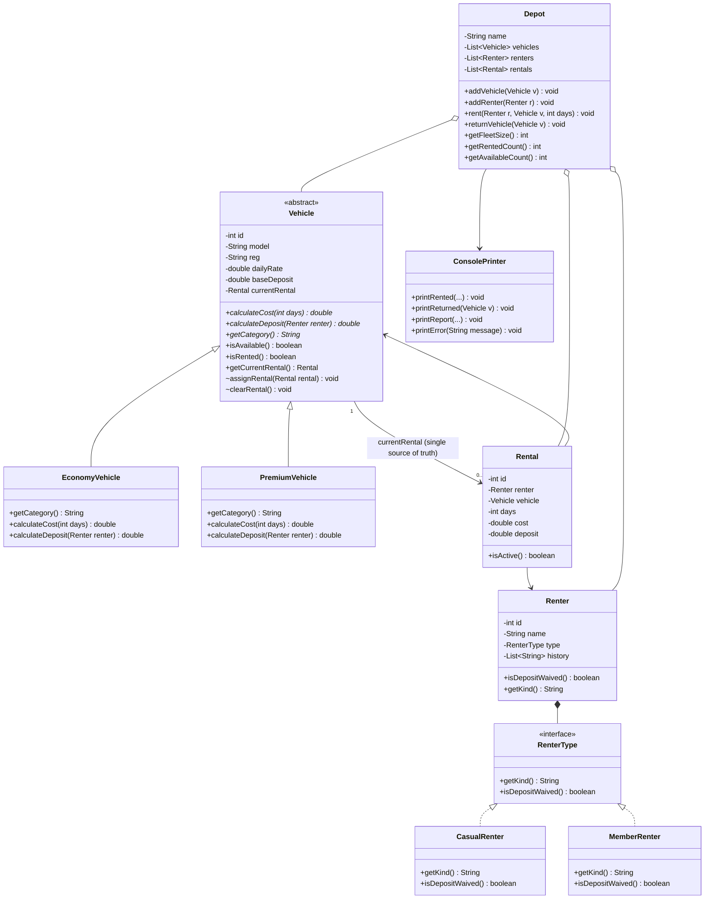

# Diagnosis of the Inherited `RentalTracker` Codebase

This diagnosis is based on reading, compiling, and running the original starter file (`src/main/java/RentalTracker.java`, 167 lines).

---

## 1. Original Program Output (Evidence Before Any Changes)

Running the untouched starter program produced:

```text
Rented Toyota Vitz (GT-1234-20) to Kofi Mensah for 3 days, cost GHS 450.0, deposit GHS 500.0
Rented Toyota Prado (GR-5678-22) to Ama Owusu for 2 days, cost GHS 1200.0, deposit GHS 0.0
Returned Toyota Prado (GR-5678-22)
Rented Toyota Vitz (GT-1234-20) to Ama Owusu for 2 days, cost GHS 300.0, deposit GHS 0.0

=== Dovewing Car Rentals - end of day ===
Fleet status:
  Toyota Vitz (GT-1234-20, ECONOMY): RENTED
  Toyota Prado (GR-5678-22, PREMIUM): AVAILABLE
Active rentals:
  Rental #1: GT-1234-20 -> Kofi Mensah (3 days)
  Rental #3: GT-1234-20 -> Ama Owusu (2 days)
```

Notice that `GT-1234-20` (Toyota Vitz) is rented out to **two people at the same time** (`Rental #1` to Kofi and `Rental #3` to Ama).

---

## 2. Ranking of Defects (Most Dangerous First)

### Most Dangerous Defect for Dovewing: Split Status State + Unchecked `rent()` (Defects #1 and #2)

1. **It breaks the business's golden rule ("a vehicle is available or rented, never both")**:
   - In `RentalTracker.main` (`src/main/java/RentalTracker.java:24-29`), Kofi rents the Toyota Vitz (`GT-1234-20`), and while Kofi still has the car, Ama rents the exact same Vitz. Both `Rental #1` and `Rental #3` appear as `ACTIVE` at the end of the day.
   - Worse, if a vehicle's category is anything other than the exact uppercase string `"ECONOMY"` or `"PREMIUM"` (for example `"economy"` or next quarter's `"COMMERCIAL_VAN"`), `Depot.rent()` skips both `if / else if` blocks (`src/main/java/RentalTracker.java:115-133`), leaves `v.status` as `"AVAILABLE"`, and **still executes line 135** (`rentals.add(new Rental(r.name, v.reg, days, cost, deposit));`). In the report, that car shows as `AVAILABLE` under `Fleet status:` **and** `ACTIVE` under `Active rentals:` at the exact same time.
2. **It directly costs Dovewing money (rates and deposits)**:
   - In that same fall-through path (`src/main/java/RentalTracker.java:114, 135`), `cost` and `deposit` remain `0`, so an active rental is recorded for **GHS 0.0 cost and GHS 0.0 deposit**.
   - Even when the category matches, a mistyped renter kind such as `"Member"` instead of `"MEMBER"` (`src/main/java/RentalTracker.java:118, 127`) silently charges a member the full casual deposit (GHS 500.0 or GHS 2000.0).

### Summary Ranking Table

| Rank | Defect | File & Lines | Concrete Business Risk |
| :--- | :--- | :--- | :--- |
| **1 (Critical)** | **Two separate status flags (`Vehicle.status` and `Rental.status`) and no availability check in `Depot.rent()`** | `RentalTracker.java:29, 41, 79, 113-136, 156-165` | Breaks the "available or rented, never both" rule and double-books physical cars on the lot. |
| **2 (Critical)** | **Silent fall-through in `Depot.rent()` creates GHS 0.0 active rentals while leaving the vehicle `AVAILABLE`** | `RentalTracker.java:114-136` | Produces the "available AND rented" contradiction and gives away rentals for GHS 0.0 cost and GHS 0.0 deposit. |
| **3 (High)** | **Duplicated category/renter `if/else` chains using raw strings (`"ECONOMY"`, `"PREMIUM"`, `"MEMBER"`)** | `RentalTracker.java:40, 59, 115-133` | A change to one vehicle class risks breaking the other; mistyped `"Member"` charges wrong deposits; adding a commercial van forces editing `Depot.rent()`. |
| **4 (High)** | **No encapsulation: all fields are `public` and `getRentals()` exposes the mutable internal list** | `RentalTracker.java:36-43, 58-62, 73-80, 95-98, 148-150` | Any caller can flip `v.status`, alter `dailyRate` or `deposit`, or mutate the active rental list outside `Depot`. |
| **5 (Medium)** | **`returnVehicle()` never checks if a car is actually rented and matches rentals by `vehicleReg` string** | `RentalTracker.java:138-146` | Returning an already-available car succeeds silently; two vehicles sharing a reg string corrupt each other's status on return. |
| **6 (Low/Structural)** | **All five classes and console I/O live in a single file (`RentalTracker.java`)** | `RentalTracker.java:1-167` | Tangled responsibilities make every pricing, reporting, or vehicle-class change touch the same file. |

---

## 3. Detailed Defect Analysis

### Defect 1: Split Sources of Truth for Status and No Guard Against Double-Renting
- **What is wrong**: `Vehicle` stores `public String status` (`"AVAILABLE"` or `"RENTED"`, line 41), while `Rental` separately stores `public String status` (`"ACTIVE"` or `"RETURNED"`, line 79). `Depot.rent()` (lines 113–136) never checks whether `v` is available before renting it.
- **Root cause**: Availability is stored in two separate mutable strings instead of being derived from a single source of truth on `Vehicle` (its current `Rental` reference, where `null` means available and non-null means rented).
- **Concrete risk to Dovewing**: Two customers are promised the same car at the same time, forcing the front desk to keep a paper backup.

### Defect 2: Unconditional `Rental` Creation Outside the Category `if / else if` Chain
- **What is wrong**: In `Depot.rent()` (lines 114–136), `cost` and `deposit` start at `0`. Lines 115–133 check `"ECONOMY"` and `"PREMIUM"` with no `else` branch, and lines 134–135 unconditionally record the rental.
- **Root cause**: Vehicle category is a raw `String` checked with `if / else if`, and execution continues when neither branch matches.
- **Concrete risk to Dovewing**: A mistyped category or new vehicle class stays `AVAILABLE` in the fleet list while having an `ACTIVE` rental for GHS 0.0 cost and GHS 0.0 deposit.

### Defect 3: Duplicated Pricing and Deposit-Waiver Logic Coupled to String Literals
- **What is wrong**: The `"ECONOMY"` branch (lines 116–123) and `"PREMIUM"` branch (lines 125–132) in `Depot.rent()` are copy-pasted blocks that both check `if (r.kind.equals("MEMBER")) { deposit = 0; }`.
- **Root cause**: Neither `Vehicle` nor `Renter` owns its own behaviour; `Depot.rent()` branches on raw strings.
- **Concrete risk to Dovewing**: Editing `Depot` to tweak premium pricing can break economy logic, and adding next quarter's commercial van requires modifying `Depot.rent()` again.

### Defect 4: Public Mutable Fields and Leaked Internal Collections
- **What is wrong**: Fields on `Vehicle` (lines 36–43), `Renter` (lines 58–62), `Rental` (lines 73–80), and `Depot` (lines 95–97) are `public`, and `Depot.getRentals()` (line 148) returns the internal `ArrayList` directly.
- **Root cause**: Missing encapsulation.
- **Concrete risk to Dovewing**: External code can overwrite `v.status = "AVAILABLE"` while a car is out or change `v.dailyRate`, corrupting fleet status and revenue.

### Defect 5: Unchecked Returns and Registration-String Matching in `returnVehicle()`
- **What is wrong**: `Depot.returnVehicle(Vehicle v)` (lines 138–146) sets `v.status = "AVAILABLE"` without checking if `v` is rented, and loops over `rentals` matching `rt.vehicleReg.equals(v.reg)`.
- **Root cause**: `Vehicle` does not hold a reference to its active `Rental`.
- **Concrete risk to Dovewing**: Staff can record a return for a car that is not rented without any warning.

### Defect 6: Single-File Monolith Mixing Domain, Service, and Console Output
- **What is wrong**: `RentalTracker`, `Vehicle`, `Renter`, `Rental`, and `Depot` are all in `src/main/java/RentalTracker.java`, and `Depot` prints directly to `System.out`.
- **Root cause**: No separation between domain model classes, fleet coordination, and console output.
- **Concrete risk to Dovewing**: Every change to console messages, pricing rules, or vehicle classes touches the same file.

---

## 4. Planned Structure for the Rebuild


